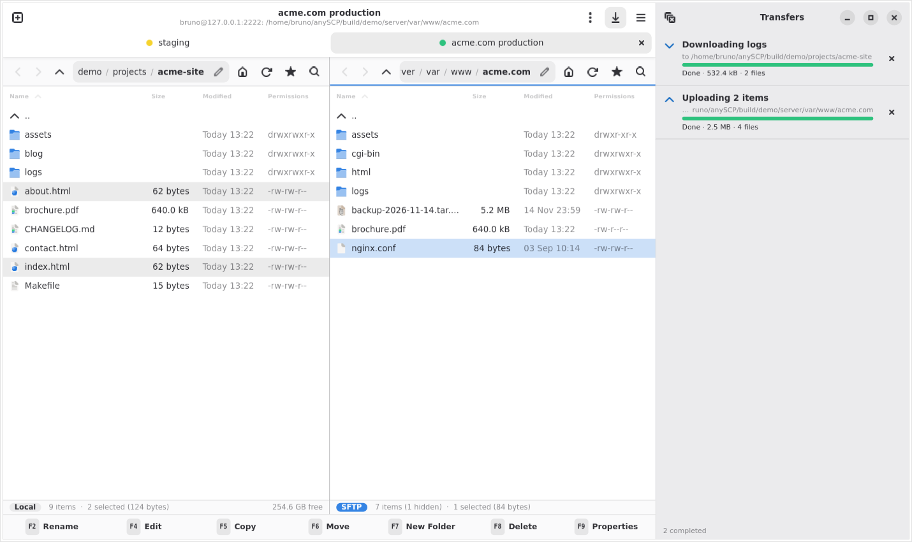
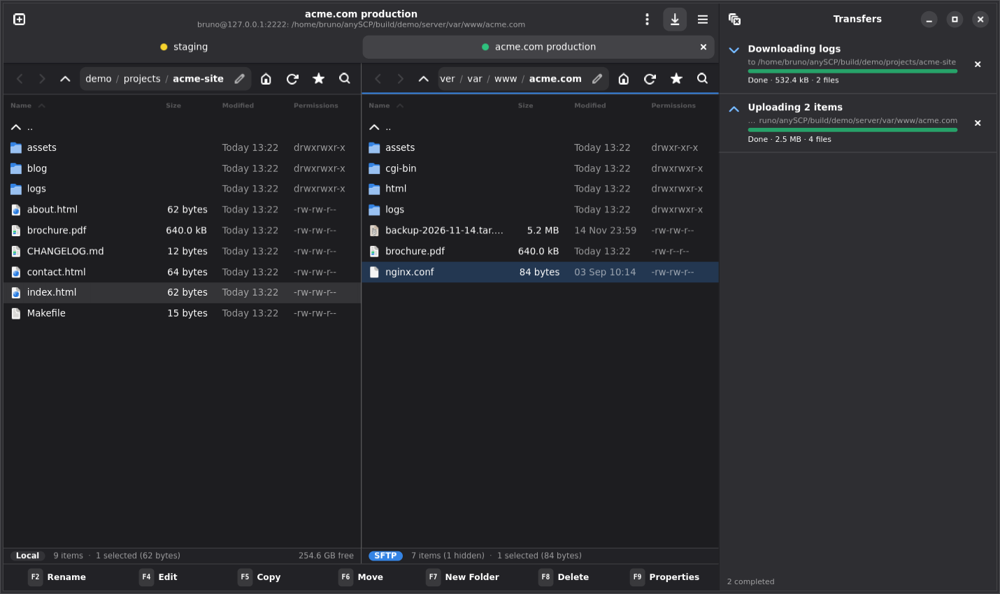
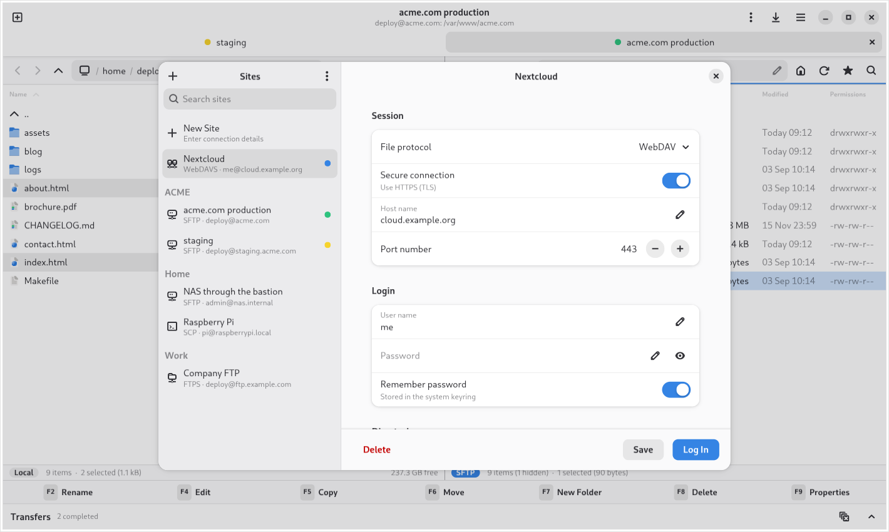
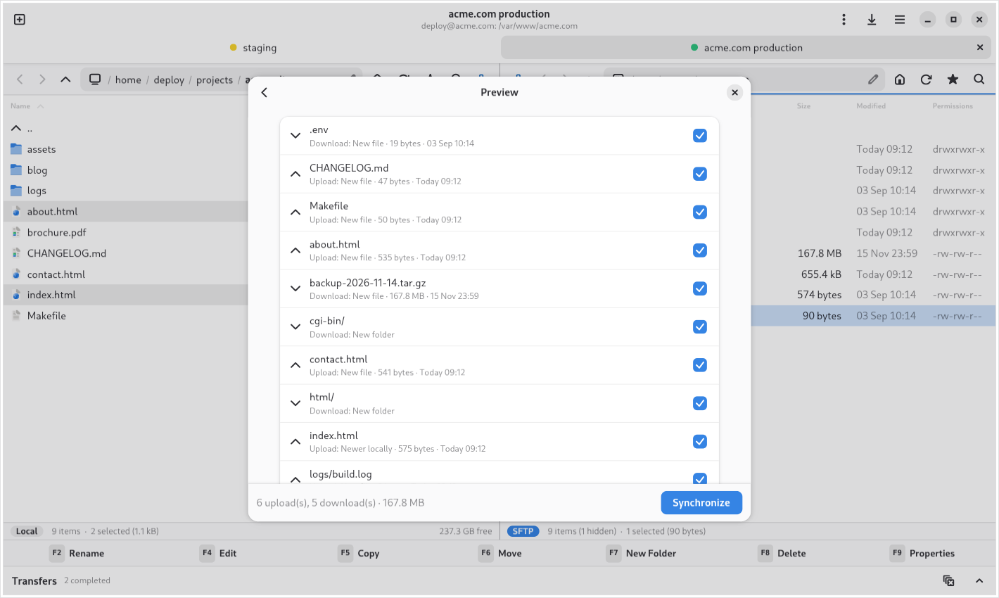
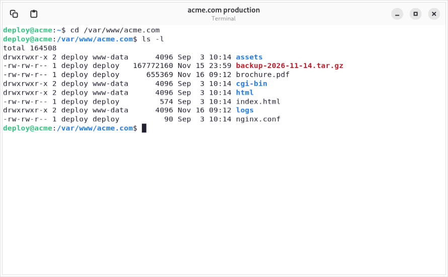
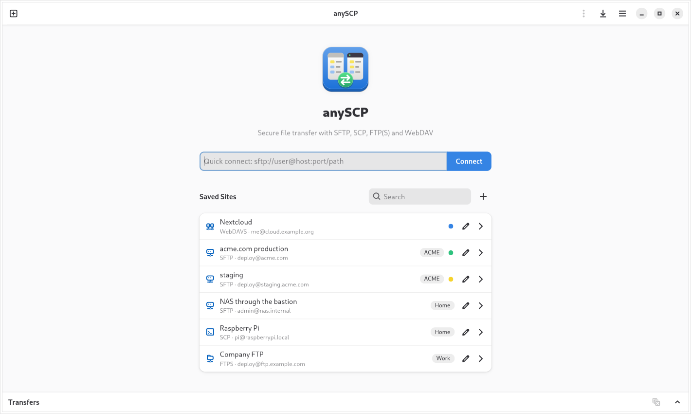
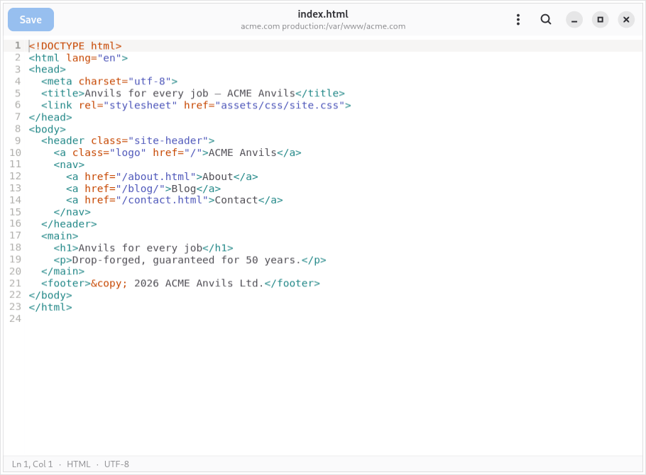

# anySCP

A file transfer client for Linux and Windows (and, experimentally, macOS) modeled on
[WinSCP](https://github.com/winscp/winscp).
It has WinSCP's two-pane *Commander* layout, transfer queue, built-in editor and
directory synchronization. The interface uses **GTK 4 and libadwaita 1.7**, the
current GNOME toolkit, so it looks native on a modern Linux desktop and follows the
system light/dark style and accent color.

WinSCP is written in Embarcadero C++Builder with the Windows-only VCL, so its
code can't be compiled for Linux. anySCP is a new implementation (Python,
PyGObject and Paramiko) that recreates WinSCP's features and workflow. It can also
import your saved WinSCP sites.



## Features

**Protocols**
- **SFTP** (SSH File Transfer Protocol) and **SCP**, using Paramiko
- **FTP**, **FTPS** with explicit and implicit TLS, using passive or active mode, MLSD/MLST or LIST parsing (Unix and IIS/DOS formats), and TLS session reuse on data connections
- **WebDAV** over HTTP or HTTPS, with Basic and Digest authentication (Nextcloud, ownCloud, Apache mod_dav, and others)

**Commander interface**
- Local and remote panes side by side with breadcrumb path bars (press Ctrl+L to type a path)
- Sortable columns (name, size, type, modified, permissions, owner). Right-click a column header to show or hide columns.
- Folders listed first, natural filename sort, hidden-file toggle (Ctrl+H), name filter (Ctrl+F), type-ahead find
- Back/forward history, bookmarks, and local places (Home, Documents, Downloads, …)
- Drag and drop between panes (hold Shift to move), from your file manager, and onto folders.
  While you drag, the folder the files would go to is highlighted: a folder's row, or the whole pane
- Select several files with a rubber band: press on empty space in a list and drag over the files
- A button at each pane's top, next to the other pane, copies the selected files across (upload or
  download, like **F5**)
- Drag files out of the window into your file manager or Windows Explorer. Files from the server are
  downloaded to a temporary folder first (shown in the queue), as in WinSCP
- WinSCP function-key bar: **F2** rename · **F4** edit · **F5** copy · **F6** move · **F7** new folder · **F8** delete · **F9** properties
- Local deletes go to the Trash; Shift+Delete deletes permanently
- Several sessions open as tabs, each with an optional color
- The local pane updates automatically when files change on disk

**Transfers**
- Transfer bar along the bottom of the window (as in WinSCP), always in view with a summary. Its list of transfers (progress, speed, time remaining, cancel, retry) opens when a transfer starts and closes 2 seconds after the last one has finished; click the bar to see the finished transfers again
- Several transfers run in parallel over extra SFTP channels on the same SSH connection, so you don't log in again
- Recursive folder transfers that follow symlinked folders, with loop protection
- Overwrite prompt: overwrite, skip, newer only, resume, or apply to all
- Resumes interrupted transfers (SFTP, FTP with REST)
- Keeps modification times, and optionally permissions

**Tools**
- **Synchronize** (Ctrl+S): local → server, server → local, or both ways; compare by time and/or size; mirror deletions; exclude patterns. Shows a preview with checkboxes before anything changes.
- **Compare directories** (Ctrl+=) and **synchronized browsing**
- **Find files** on the server by pattern (Ctrl+Shift+F)
- **Built-in editor** (GtkSourceView 5): syntax highlighting, search and replace, and saving straight back to the server
- **Open with your default app**: anySCP downloads the file, watches it, and uploads it again each time you save (like WinSCP)
- **Terminal** (VTE): a real shell in a window that reuses the session's SSH connection, so there's no second login (Ctrl+Shift+T)
- **Properties**: chmod with a checkbox grid or octal value, recursive with `X` for folders; chown/chgrp; folder size calculation
- Server and protocol information (cipher, MAC, key exchange, host key fingerprint) and a session log

**Security and sites**
- Site manager with folders, colors, notes and per-site settings, plus **Quick Connect** with URLs such as `sftp://user@host:port/path`.
  **Log In** saves the site first, so a new site is never lost
- The Sites dialog is a window of its own: resize and maximize it as you like; it opens at the
  size it had last time. Escape still closes it
- A site's remote directory can be relative to your home folder on the server (`www` or `~/www`). If it
  can't be opened (renamed, mistyped), anySCP opens your home folder instead and says why
- Passwords are stored in the **GNOME Keyring** (libsecret), never in plain text
- SSH host key checks against `~/.ssh/known_hosts` and anySCP's own cache, with clear warnings for unknown or changed keys
- Authentication by public key (OpenSSH keys; the passphrase can be remembered), the SSH agent, password, or keyboard-interactive (2FA/OTP)
- **Jump hosts** for SFTP and SCP sites: connect through one or more SSH servers in series, like `ssh -J`.
  Each jump host has its own login (user, password, private key and passphrase, all of which can be
  remembered) and its own proxy. While connecting, the session shows each machine of the way and how
  far the connection got
- **Proxy** per site and per jump host: SOCKS5 (with or without a login), SOCKS4/4a or HTTP (`CONNECT`).
  A jump host's proxy reaches that jump host; the site's proxy reaches the server, through the jump hosts if any
- Host aliases from `~/.ssh/config` (HostName, User, Port, IdentityFile, ProxyCommand), and its `ProxyJump`
  jump hosts, through anySCP's own connections (no `ssh` program needed)
- TLS certificates are verified against the system CA store; an untrusted certificate prompts you to trust it once or always
- **Imports sites from WinSCP.ini**, including saved passwords that aren't protected by a master password

| | |
|---|---|
|  |  |
|  |  |
|  |  |

## Download and run (portable, nothing to install)

Download the file for your system from the
[Releases page](https://github.com/brunosalezze/anySCP/releases). What changed in each
version: [CHANGELOG.md](CHANGELOG.md).

| Platform | File | How to run |
|---|---|---|
| Linux (x86-64, glibc ≥ 2.28) | `anySCP-1.1.1-x86_64.AppImage` | `chmod +x anySCP-*.AppImage && ./anySCP-*.AppImage` |
| Linux (arm64: Raspberry Pi 4/5 with a 64-bit OS, ARM servers; glibc ≥ 2.28) | `anySCP-1.1.1-aarch64.AppImage` | the same |
| Windows 10/11 (x64) | `anySCP-1.1.1-windows-x64.exe` | Double-click. The first start takes a little longer while it unpacks itself. |
| Windows 11 on ARM (Snapdragon PCs, Surface Pro X/11) | `anySCP-1.1.1-windows-arm64.exe` | the same |
| macOS 11 or newer on Apple Silicon (M1 and later), **experimental** | `anySCP-1.1.1-macos-arm64.dmg` | Open it and drag anySCP to Applications; the first start needs your approval, see below. |

Each one includes Python, GTK 4.24, libadwaita 1.10 and every other dependency.
(Windows on ARM can also run the x64 build, emulated; the arm64 one runs natively and is faster.)
If an AppImage says it cannot mount itself (no FUSE, as on minimal or headless systems), install
`fuse3` or start it with `--appimage-extract-and-run`.

**macOS is experimental.** The app is built and self-tested automatically on GitHub's
Apple Silicon Macs, but nobody has tried it on a real Mac yet: reports are welcome. Intel
Macs are not supported. There the terminal opens in Terminal.app, saved passwords go
into the Keychain, and the shortcuts use ⌘ instead of Ctrl. The app is not notarized by
Apple (that needs a paid Apple Developer ID), so macOS blocks its first start: open it
once, then go to System Settings → Privacy & Security and click **Open Anyway** (on
macOS 14 and older, Control-click the app and choose Open). In a terminal,
`xattr -dr com.apple.quarantine /Applications/anySCP.app` does the same.
On macOS, settings live in `~/Library/Application Support/anySCP` (portable mode
only if you create an `anySCP-data` folder next to anySCP.app yourself).
The packages are **portable**. On first start they create an `anySCP-data`
folder next to themselves, and all settings, saved sites and host keys live
there, so you can carry anySCP on a USB stick. If that location isn't writable,
the normal per-user folders are used instead. Set `ANYSCP_PORTABLE=0` to always
use the per-user folders. Saved passwords stay in the system keyring or
Windows Credential Manager of each computer, never in the folder. See
[packaging/README.md](packaging/README.md) to build them yourself, and
[CODE_SIGNING_POLICY.md](CODE_SIGNING_POLICY.md) for the code signing policy of the Windows programs.
anySCP collects no data and connects only to the servers you enter; see the
[privacy policy](PRIVACY.md).

### Running from a network share (SMB/NFS)

You can put anySCP on a file server and start it from there on several PCs.
For example `\\server\apps\anySCP\anySCP.exe`, a mapped drive, or an
AppImage on an NFS/SMB mount.

- **Windows:** the program files are copied once per version to
  `%LOCALAPPDATA%\anySCP\runtime-<id>` and run from there. This makes
  starting fast, works around Windows' limits on loading DLLs from UNC paths,
  and keeps the files on the share unlocked, so an admin can replace them
  while people are using it.
- **Settings:** if the share is writable, settings are kept in `anySCP-data`
  next to the program. Several people or PCs can use it at the same time
  safely, because writes are atomic, retried on lock conflicts and merged.
  On a read-only share, each user's settings go to their own profile.
- **If something doesn't work:** run `anySCP.exe --self-test` (or
  `./anySCP-*.AppImage --self-test`). It starts the app, checks paths, the
  settings folder, libraries, fonts and the password store, and shows a report.
  These scenarios are covered by automated tests; see
  [tests/shares/README.md](tests/shares/README.md).

On Windows, passwords go to the Windows Credential Manager. The terminal opens
Windows Terminal or cmd with the built-in OpenSSH client, because the embedded
VTE terminal is Linux-only.

## Requirements (running from source)

- Python ≥ 3.11
- GTK ≥ 4.12 and libadwaita ≥ 1.5 (1.7 recommended), with PyGObject
- Paramiko ≥ 3.2 and cryptography ≥ 42
- Optional: GtkSourceView 5 (editor highlighting), VTE for GTK 4 (terminal), libsecret (keyring)

Debian 13, Ubuntu 25.04 or newer:

```sh
sudo apt install python3-gi gir1.2-gtk-4.0 gir1.2-adw-1 python3-paramiko \
                 gir1.2-gtksource-5 gir1.2-vte-3.91 gir1.2-secret-1
```

**Ubuntu 24.04 LTS and older are not supported from source**: their Paramiko (2.12) and
cryptography (41) are older than anySCP needs. Use the AppImage there; it brings its own.

Fedora:

```sh
sudo dnf install python3-gobject gtk4 libadwaita python3-paramiko gtksourceview5 vte291-gtk4 libsecret
```

## Running

From the source tree:

```sh
./anyscp.sh                         # start
./anyscp.sh sftp://me@example.com   # start and connect straight away
```

Install for your user (adds the app to your applications menu and `~/.local/bin/anyscp`):

```sh
./install.sh
./install.sh --uninstall
```

Or with pip: `pip install --user .` (PyGObject and GTK still come from your distribution).

## Importing from WinSCP

On Windows, export your configuration: **WinSCP → Tools → Export/Backup Configuration**
(or copy `WinSCP.ini`). Then in anySCP choose **Main menu → Import Sites from WinSCP…**.
anySCP imports host, port, user, protocol, FTPS mode, remote directory, folder, color,
notes, proxy (SOCKS4/5, HTTP) and SSH tunnel (as a jump host), and can save the passwords to
your keyring. Proxy passwords are not imported: enter them in the site's settings.

PuTTY `.ppk` keys must be converted first:
`puttygen key.ppk -O private-openssh -o ~/.ssh/id_mykey`.

## Keyboard shortcuts

Press **Ctrl+?** in the app for the full list. The most used:

| Key | Action | Key | Action |
|---|---|---|---|
| F5 | Copy to the other side | Ctrl+N | New session / site manager |
| F6 | Move to the other side | Ctrl+W | Close session |
| F7 | New folder | Ctrl+J | Transfer queue |
| F8 / Delete | Delete | Ctrl+S | Synchronize |
| F2 | Rename | Ctrl+R | Refresh |
| F4 | Edit | Ctrl+L | Type a path |
| F9 | Properties | Backspace | Parent folder |

## Files

| Path | Contents |
|---|---|
| `~/.config/anyscp/sites.json` | Saved sites (no passwords) |
| `~/.config/anyscp/settings.json` | Preferences |
| `~/.config/anyscp/known_hosts` | Host keys you accepted in anySCP |
| `~/.config/anyscp/trusted_certs.json` | TLS certificates you chose to trust |
| GNOME Keyring | Saved passwords |
| `~/.cache/anyscp/edit/` | Temporary copies of files opened in external apps |

## Development

```
anyscp/
  backends/   base.py (FileSystem API) · local · ssh (auth) · sftp · scp · ftp · webdav
  transfer.py queue, jobs, overwrite/resume logic        sync.py   directory comparison
  session.py  connection + worker thread + transfer pool winscp_import.py
  ui/         window, session_page, file_pane, queue_panel, site_dialog, editor,
              terminal, properties, sync_dialog, find_dialog, preferences, …
tests/        integration tests against a throwaway OpenSSH server, pyftpdlib and wsgidav
```

All network I/O runs on worker threads; results come back to the GTK main loop with
`GLib.idle_add`, so the interface never blocks.

Run the tests (they start their own sshd, FTP and WebDAV servers on free ports and never
touch your real configuration):

```sh
python3 -m venv --system-site-packages .venv
.venv/bin/pip install pytest pyftpdlib pyopenssl wsgidav cheroot
.venv/bin/python -m pytest -q
```

The screenshots in `docs/screenshots` are made by `python3 docs/screenshots/generate.py`
(a demo site on a local test server, under Xvfb; needs the AppImage build's runtime).

## Not (yet) supported

- Amazon S3
- PuTTY `.ppk` keys (convert them with `puttygen`)
- WinSCP passwords protected by a master password
- Telnet and local-command proxies (WinSCP has them), and SSH tunnels for FTP or WebDAV sites
- Scripting / command-line batch mode

## License

anySCP is free software: you can redistribute it and/or modify it under the
terms of the **GNU General Public License, version 3 or (at your option) any
later version** (see [LICENSE](LICENSE)). The license matches WinSCP's own (GPL-3.0).

anySCP is an independent project, **not affiliated with or endorsed by
WinSCP**. It contains no WinSCP code, icons or artwork, except one small routine
that decodes passwords stored in `WinSCP.ini`. That routine is ported from
WinSCP for compatibility, and its origin is credited in the code. See
[THIRD-PARTY-NOTICES.md](THIRD-PARTY-NOTICES.md) for details and for the
licenses of the components bundled in the AppImage and Windows packages.

